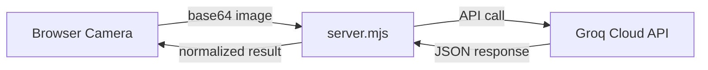

# Replacing Groq API with a Trained Model in Watch Guard

## Current Architecture

Your app currently works like this:



The **Groq API** is used as a **vision LLM** — it receives camera frames as base64 images, reads a giant prompt describing what to look for, and returns a structured JSON classification (status, failure type, severity, bounding box, etc.)

## Your Options to Replace Groq

### Option 1: Train a Custom CV Model (Recommended for Production)

Train a **computer vision classification model** (e.g., YOLOv8 or a CNN) and serve it locally via a Python API.

**What you'd train:**
- An image classifier for: `normal`, `spaghetti`, `bed_adhesion`, `detachment`, `layer_shift`, etc.
- Optionally an object detector (YOLOv8) for failure bounding boxes

**Steps:**

1. **Collect & label training data** — camera frames labelled with failure types
2. **Train the model** in Python (PyTorch / Ultralytics YOLOv8)
3. **Serve it locally** with FastAPI or Flask
4. **Replace the Groq call** in `server.mjs` with a `fetch()` to your local Python server

**Example Python inference server (`model_server.py`):**

```python
from fastapi import FastAPI
from pydantic import BaseModel
import base64, io, torch
from PIL import Image
from ultralytics import YOLO  # or your custom model

app = FastAPI()
model = YOLO("your_trained_model.pt")  # Load your trained model

class AnalyzeRequest(BaseModel):
    image: str  # base64 data URL

@app.post("/predict")
async def predict(req: AnalyzeRequest):
    # Decode the base64 image
    header, data = req.image.split(",", 1)
    img = Image.open(io.BytesIO(base64.b64decode(data)))
    
    # Run inference
    results = model(img)
    
    # Map results to Watch Guard expected format
    return {
        "scene_state": "printing_normally",
        "material_pattern": "intentional_solid_geometry",
        "attachment_state": "attached_flat",
        "loose_filament_extent": "none",
        "build_plate_visible": True,
        "printed_part_visible": True,
        "failed_material_visible": False,
        "temporal_change_detected": False,
        "machine_status": "printing",
        "status_confidence": 0.95,
        "machine_status_reason": "Print running normally",
        "detected_colors": [],
        "status": "normal",
        "failure_type": "none",
        "failure_box": {"x": 0, "y": 0, "width": 0, "height": 0},
        "confidence": 0.95,
        "severity": 0,
        "should_notify_user": False,
        "recommended_action": "continue",
        "reason": "Print appears normal",
        "evidence": "No visible issues",
        "probable_cause": "none",
        "next_step": "Continue monitoring"
    }
```

**Changes needed in `server.mjs`:**

Replace the `requestAnalysis()` function (lines 528–571) with a local HTTP call:

```javascript
async function requestAnalysis(content) {
    // Extract the current image from the content array
    const imageItem = content.find(c => c.type === "image_url");
    const imageDataUrl = imageItem?.image_url?.url;

    const res = await fetch("http://localhost:8000/predict", {
        method: "POST",
        headers: { "Content-Type": "application/json" },
        body: JSON.stringify({ image: imageDataUrl }),
    });

    if (!res.ok) throw new Error(`Model server error: ${res.status}`);
    const rawResult = await res.json();
    return { rawResult, attempts: 1 };
}
```

---

### Option 2: Run an Open-Source Vision LLM Locally (Easiest Swap)

Use **Ollama** or **llama.cpp** to run a vision-capable model (like LLaVA, Qwen2-VL) locally. This keeps the same prompt-based approach but removes the API dependency.

**Steps:**

1. Install [Ollama](https://ollama.com/) 
2. Pull a vision model: `ollama pull llava:13b`
3. Change `server.mjs` to call Ollama's local API instead of Groq

**Changes in `server.mjs`:**

```javascript
// Replace the Groq SDK call with Ollama's OpenAI-compatible API
async function requestAnalysis(content) {
    const response = await fetch("http://localhost:11434/v1/chat/completions", {
        method: "POST",
        headers: { "Content-Type": "application/json" },
        body: JSON.stringify({
            model: "llava:13b",
            messages: [{ role: "user", content }],
            format: "json",
            temperature: 0,
            stream: false,
        }),
    });

    const data = await response.json();
    const rawText = data.choices[0]?.message?.content;
    return { rawResult: JSON.parse(extractJson(rawText)), attempts: 1 };
}
```

> [!WARNING]
> Local LLMs need a good GPU (8+ GB VRAM). Without one, inference will be very slow (30–60+ seconds per frame).

---

### Option 3: Use a Different Cloud API (Cheapest Change)

Swap Groq for another provider that supports vision (OpenAI, Google Gemini, Anthropic). The prompt stays the same — only the SDK/fetch call changes.

| Provider | SDK | Model |
|----------|-----|-------|
| OpenAI | `openai` | `gpt-4o-mini` |
| Google | `@google/generative-ai` | `gemini-2.0-flash` |
| Anthropic | `@anthropic-ai/sdk` | `claude-sonnet-4-20250514` |

---

## Comparison

| Approach | Cost | Latency | Accuracy | Effort |
|----------|------|---------|----------|--------|
| **Custom CV Model** | Free (local) | ~50ms | High (if well-trained) | High — need labeled data + training |
| **Local LLM (Ollama)** | Free (local) | 5–30s | Moderate | Low — drop-in replacement |
| **Different Cloud API** | Pay-per-use | 1–3s | High | Low — SDK swap |

## What I Recommend

If you have **labeled training images** of 3D printer failures → go with **Option 1** (custom YOLOv8). It's the fastest at inference, free to run, and doesn't need internet.

If you want the **quickest swap** with no training → go with **Option 2** (Ollama) to keep the same prompt-based architecture running locally.
